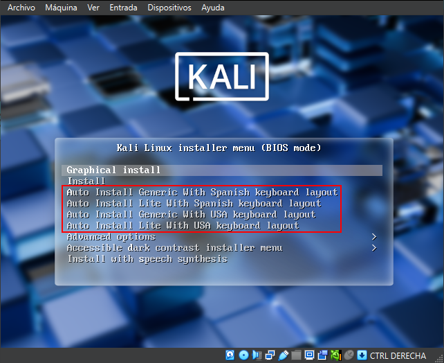
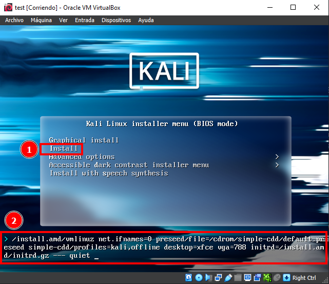
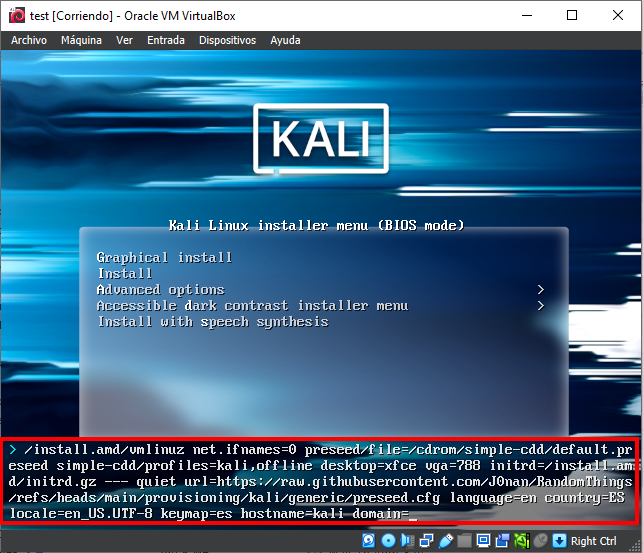

# AutoKali <!-- omit in toc -->
Kali configuration for unattended installations with some extra tools for day to day use.
There are several types of configurations available to use.

## Table of Content <!-- omit in toc -->

- [Types of machines available](#types-of-machines-available)
  - [Generic](#generic)
  - [Lite](#lite)
- [Install](#install)
  - [Automatic Install](#automatic-install)
  - [Manual Install](#manual-install)

## Types of machines available

### Generic

A comprehensive set of tools for daily use. For more details read [this](./generic/).

### Lite

A trim down version of the generic version so it installs faster and takes less space. For more details read [this](./lite/).

## Install

This guide is focused in Kali Linux using VirtualBox

### Automatic Install

This guide uses a custom ISO made using [GitHub Actions](.github/workflows/create-unattended-kali.yml) and uploaded to the releases of this repository.

1. [Download](https://github.com/J0nan/AutoKali/releases) the modified ISO. I recommend to download one part at a time, because sometimes if you download several parts at the same time it is likely to failed.
2. Decompress the downloaded files.
3. Create a new Virtual Machine.
4. Configure the Hardware, I recommend a minimum of 4096 MB of RAM, 3 CPUs processors and 100 GB of Hard Drive (it can be higher, depending on your hardware).
5. Before booting the VM, change the display setting to use at least 32 MB of Video memory in order to be able to rescale on bigger screen and with higher resolutions.
6. Boot the VirtualMachine.
7. Select one of the two auto install options and wait until Kali is installed.

<center>  </center>

Sometimes for some reason, the cursor glitches out, if that happens just restart lightdm with:

```bash
sudo systemctl restart lightdm
```

### Manual Install

1. [Download](https://www.kali.org/get-kali/#kali-installer-images) Kali Linux.
2. Create a new Virtual Machine.
3. Configure the Hardware, I recommend a minimum of 4096 MB of RAM, 3 CPUs processors and 100 GB of Hard Drive (it can be higher, depending on your hardware).
4. Before booting the VM, change the display setting to use at least 32 MB of Video memory in order to be able to rescale on bigger screen and with higher resolutions.
5. Boot the VirtualMachine.
6. Once booted go to Install and press the `Tab` key instead of the `Enter`, this will show a command line at the bottom, as shown in the next picture.

<center>  </center>

7. Once the command line is shown add the following changing the language, country, locale and keymap if needed. If you are not able to copy and paste, you can use any [Pastebin Services](https://github.com/lorien/awesome-pastebins) to copy and paste the content of the preseed.cfg file and type a shorter url instead of the one from Github. Also, you can use [ClickPaste](https://github.com/Collective-Software/ClickPaste) to paste into the Virtual Machine.

```shell
url=https://raw.githubusercontent.com/J0nan/AutoKali/refs/heads/main/generic/preseed.cfg language=en country=ES locale=en_US.UTF-8 keymap=es hostname=kali domain=
```

<center>  </center>

8. After entering the command press `Enter` and wait until Kali is installed.

Sometimes for some reason, the cursor glitches out, if that happens just restart lightdm with:

```bash
sudo systemctl restart lightdm
```
